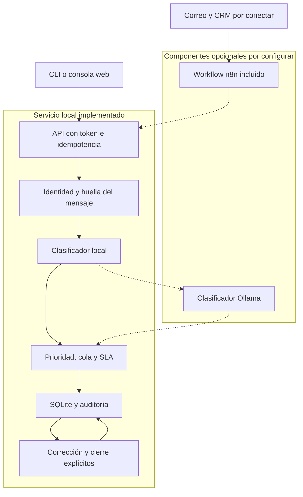

# Arquitectura

[Abrir SVG](diagrams/architecture.svg) · [Fuente Mermaid](diagrams/architecture.mmd)

El servicio transforma un mensaje en una clasificación operativa y un vencimiento. Deduplicación, política de prioridades y revisión pertenecen al dominio; el modelo es un clasificador intercambiable.

Versión Mermaid

Las líneas continuas muestran el recorrido implementado dentro de cada límite. Las líneas discontinuas indican componentes opcionales, entregados para configurar o aún por conectar; su estado se precisa en [tecnologías](technologies.md).

La API ejecuta cada solicitud en una transacción y conserva su respuesta con la clave de idempotencia. El dominio añade deduplicación por `tenant`, canal e identificador externo: una reentrega con contenido distinto se rechaza.

Las consultas y mutaciones filtran por `tenant`. Este campo delimita datos en la aplicación; el token compartido no implementa identidad de usuario ni roles. En una instalación multiusuario, el adaptador de autenticación debe derivar el tenant de la identidad validada y controlar las acciones de revisión.

La clasificación local utiliza vocabulario explícito; empates e incertidumbre se envían a revisión. Ollama es un clasificador opcional con salida estructurada. Las decisiones operativas y las transiciones siguen perteneciendo al dominio.

[Flujo de operación](flow.md) · [Tecnologías y alcance](technologies.md)
