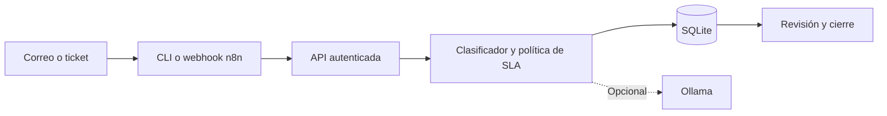

# Arquitectura

La API ejecuta cada solicitud en una transacción y conserva su respuesta con la clave de idempotencia. El dominio añade deduplicación por `tenant`, canal e identificador externo: una reentrega con contenido distinto se rechaza.

Las consultas y mutaciones filtran por `tenant`. Este campo delimita datos en la aplicación; el token compartido no implementa identidad de usuario ni roles. En una instalación multiusuario, el adaptador de autenticación debe derivar el tenant de la identidad validada y controlar las acciones de revisión.

La clasificación local utiliza vocabulario explícito; empates e incertidumbre se envían a revisión. Ollama es un clasificador opcional con salida estructurada. Las decisiones operativas y las transiciones siguen perteneciendo al dominio.
