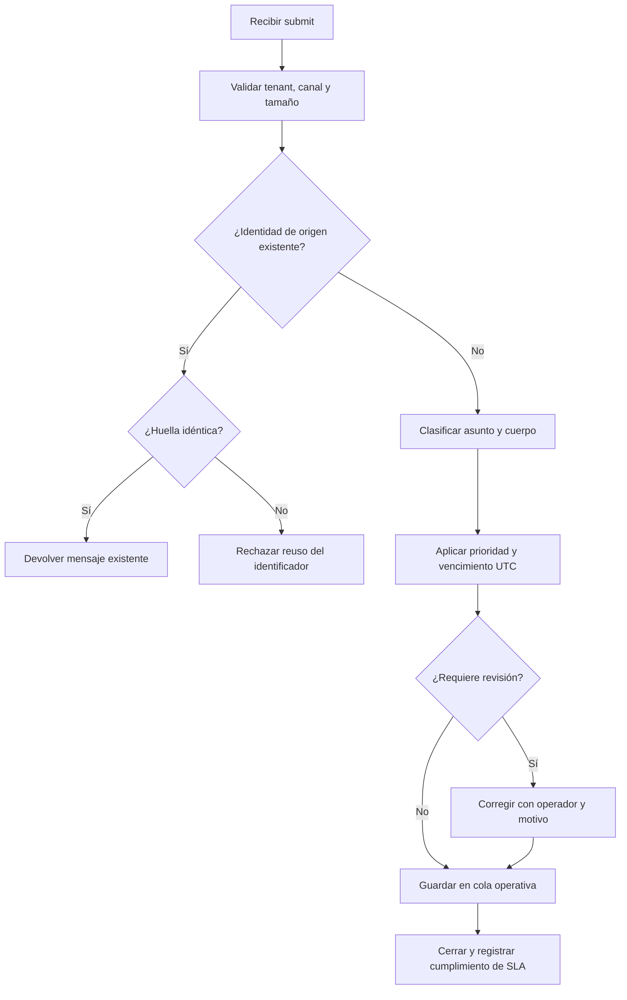

# Flujo de operación

[Abrir SVG](diagrams/flow.svg) · [Fuente Mermaid](diagrams/flow.mmd)

Versión Mermaid

- La identidad de negocio combina `tenant`, canal e identificador externo; otra carga con esa identidad se rechaza.
- Ollama puede proponer categoría y confianza. Las prioridades y plazos se calculan con reglas del servicio.
- `override` conserva la recepción original al recalcular el vencimiento; `close` exige resolver primero la revisión.

Las operaciones del dominio se guardan junto a auditoría y respuesta idempotente en la transacción del servicio local. Un error revierte los cambios de esa solicitud.

[Arquitectura](architecture.md) · [Tecnologías y alcance](technologies.md)
